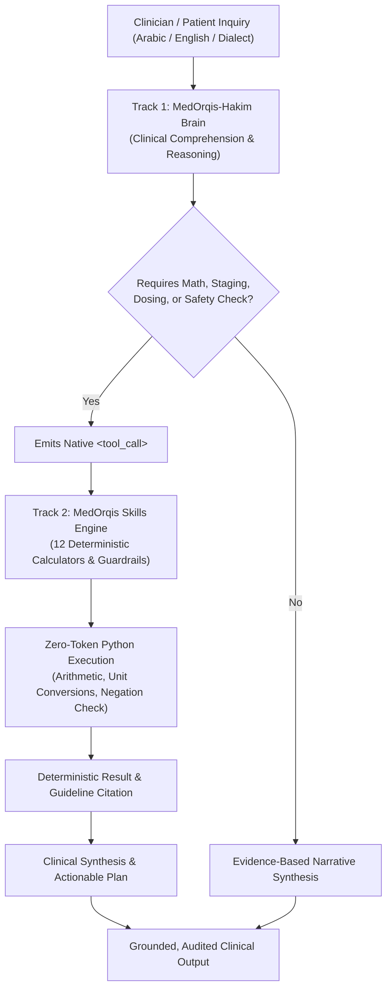

# MedOrqis Medical Foundation Model: Architecture & Governance

## Executive Summary

The **MedOrqis Medical Foundation Model** (`MedOrqis-Hakim-6B` / `MedOrqis-Karnak-40B`) is an open-weights, bilingual (Arabic & English) clinical decision-intelligence foundation model designed to operate synergistically with the **MedOrqis Deterministic Skills Engine**.

Built upon `Applied-Innovation-Center/Karnak-6B-v1.0` (Qwen3 architecture) and trained via QLoRA 4-bit NF4, it addresses the fundamental vulnerability of medical AI: **probabilistic clinical hallucination in clinical calculations and safety-critical decisions**.

---

## 🏛️ The Dual-Track Architecture



### Track 1: The Clinical Brain (`MedOrqis-Hakim-6B`)
- **Base Foundation**: `Applied-Innovation-Center/Karnak-6B-v1.0` (AIC / Qwen3).
- **Core Competencies**:
  - Medical narrative comprehension in Modern Standard Arabic, Medical English, and regional dialects (e.g. Egyptian colloquialisms like "كرشة نفس", "حرقان ف فم المعدة").
  - Clinical entity extraction and mapping to SNOMED-CT and ICD-10.
  - Multi-turn clinical reasoning and differential diagnosis formulation.
  - Generating structured function calls (`<tool_call>`) formatted for MedOrqis tools.

### Track 2: The Deterministic Skills Engine
- **Core Competencies**:
  - Zero-token local Python functions executing certified clinical formulas.
  - Strict input boundary and physiological plausibility checks.
  - Multi-layered safety guardrails (red flag escalation, fatal DDI blocking, PHI de-identification).

---

## 🧮 Integrated Deterministic Calculators

| Tool ID | Scientific Reference | Validated Scope |
| :--- | :--- | :--- |
| `cha2ds2_va_esc2024` | 2024 ESC Atrial Fibrillation Guidelines | Adult non-valvular AF stroke risk (sex category removed). |
| `ckd_epi_2021_egfr` | 2021 NKF-ASN / KDIGO 2024 | Adult race-free estimated glomerular filtration rate. |
| `bedside_schwartz_egfr` | KDIGO Pediatric Nephrology | Pediatric eGFR (k * height / SCr) for ages 0-18. |
| `cockcroft_gault_crcl` | FDA Renal Guidance | Creatinine clearance for renal drug dose adjustments. |
| `curb65_score` | BTS Guidelines | Community-acquired pneumonia severity and ICU admission criteria. |
| `wells_pe_score` | Wells Criteria (Lancet / Thromb Haemost) | Pre-test probability of Pulmonary Embolism & diagnostic pathway. |
| `wells_dvt_score` | Wells DVT Criteria | Deep vein thrombosis pre-test stratification. |
| `has_bled_score` | Chest 2010 | Bleeding risk in patients receiving oral anticoagulants. |
| `news2_score` | Royal College of Physicians 2017 | National Early Warning Score for acute clinical deterioration. |
| `pediatric_weight_dose` | AAP Pediatric Dosing Protocols | Weight-based dose calculation with mandatory adult single-dose ceiling. |
| `check_drug_interactions` | MedOrqis DDI Database | Multi-drug screening for fatal / major pharmacokinetic interactions. |
| `check_red_flags` | Multi-Specialty Emergency Guidelines | Rapid identification of high-acuity surgical and medical emergencies. |
| `scrub_phi` | HIPAA 18 Safe Harbor & Regional Law | Redaction of Egyptian NID, Saudi Iqama, phone numbers, and names. |

---

## 🚀 Cloud Training Workflows

### Option A: 100% Free Training via Google Colab (T4 GPU)
- **Target Model**: `MedOrqis-Hakim-6B`
- **Hardware Requirement**: Google Colab Free Tier (1x NVIDIA T4 16GB VRAM)
- **Local Cost / Bandwidth**: $0.00 / 0 Bytes downloaded locally.
- **Duration**: ~20-25 minutes.
- **Notebook**: [`training/MedOrqis_Free_Training_Colab.ipynb`](../training/MedOrqis_Free_Training_Colab.ipynb)
- **Direct Link**: [](https://colab.research.google.com/github/seotarek/MedOrqis/blob/main/training/MedOrqis_Free_Training_Colab.ipynb)

### Option B: Cloud Scaled Training via RunPod (A100 GPU)
- **Target Model**: `MedOrqis-Karnak-40B`
- **Hardware Requirement**: NVIDIA A100 PCIe (80GB VRAM) on RunPod
- **Cost**: ~$1.19/hour (~$2 total for 1.5 hours)
- **CLI Trigger**:
  ```bash
  python3 training/runpod_manager.py launch --gpu "NVIDIA A100-PCIE-80GB"
  ```

---

## 📊 Published Repositories

- **Model Hub**: [https://huggingface.co/seotarek/medorqis-hakim-6b](https://huggingface.co/seotarek/medorqis-hakim-6b)
- **Instruction Dataset**: [https://huggingface.co/datasets/seotarek/medorqis-clinical-instructions](https://huggingface.co/datasets/seotarek/medorqis-clinical-instructions)
- **Dialect Benchmark Dataset**: [https://huggingface.co/datasets/seotarek/medorqis-clinical-dialect-benchmark](https://huggingface.co/datasets/seotarek/medorqis-clinical-dialect-benchmark)
- **Source Code**: [https://github.com/seotarek/MedOrqis](https://github.com/seotarek/MedOrqis)

---

## 🛡️ Medical Disclaimer & Governance
MedOrqis-Hakim is an experimental clinical decision-support tool designed for licensed medical professionals, researchers, and educational exploration. It is **not** an autonomous medical device and must never substitute for clinical judgment, diagnostic verification, or personalized physician consultation.
